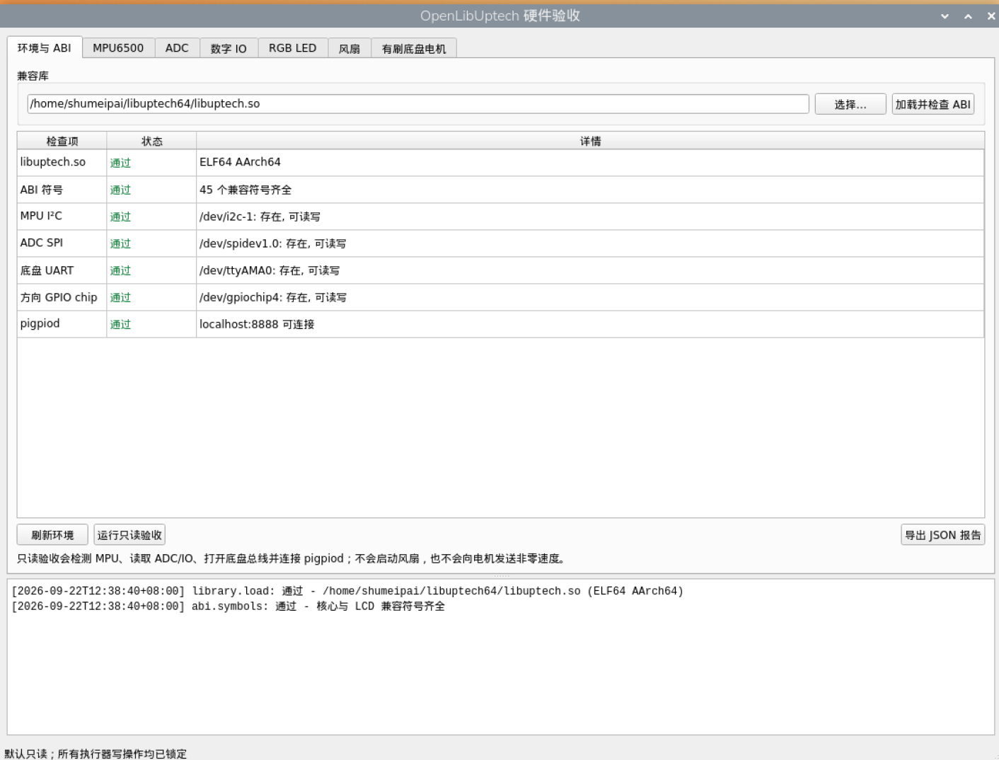

# OpenLibUptech

[中文](README.md) · [English](README.en.md) · [完整教程](docs/TUTORIAL.md)

> 把旧版 ARM32 `libuptech.so` 的可用接口带到 64 位 Raspberry Pi OS。

## 项目定位

OpenLibUptech 是根据原有 32 位系统镜像、Python 封装、ABI 和实机协议复刻的开源兼容实现。仓库同时提供 C 源码和一份已经在 Raspberry Pi AArch64 上验证过的 `libuptech.so`，方便直接使用或自行重编译。

它不是原厂源码，也不重新发布原厂 ARM32 镜像。原版函数名和主要 ctypes 调用约定被保留，底层实现改为可检查、可编译的 C 代码。

## 已验证功能

| 模块 | 当前实现 |
| --- | --- |
| ADC / 数字 IO / RGB | `/dev/spidev1.0`；9 路 ADC、8 路 IO、2 颗 RGB LED |
| MPU6500 | `/dev/i2c-1`、地址 `0x68`；10 ms 默认缓存；加速度、陀螺仪和软件互补姿态 |
| 底盘 | `/dev/ttyAMA0`、GPIO4 半双工；ID7/ID8 有刷电机 |
| 风扇 | GPIO18、pigpiod；CPU 温度自动 PWM（20%–100%，800 Hz），支持短时安全手动覆盖 |
| 验收界面 | PyQt6：环境、MPU、ADC、IO、RGB、风扇、电机页面 |

## 快速开始

在 64 位 Raspberry Pi OS 上：

```bash
sudo apt update
sudo apt install -y build-essential python3-pyqt6 python3-pigpio pigpio i2c-tools
file ./libuptech.so
python3 abi_smoke.py ./libuptech.so
python3 acceptance_gui.py ./libuptech.so
```

`file` 应报告 `ELF 64-bit ... ARM aarch64`。完整的总线配置、服务安装、权限、验收步骤和回滚方式见[完整教程](docs/TUTORIAL.md)。

## 仓库内容

- `README.en.md`：English entry page；
- `libuptech.c` / `Makefile`：兼容库源码和构建入口；
- `libuptech.so`：已验证的 AArch64 预编译库，仅适用于 Linux ARM64；
- `acceptance_gui.py`：硬件验收界面；
- `abi_smoke.py`：ABI 检查（不打开设备）；`live_mpu_test.py` 会初始化 MPU 寄存器；
- `uptech_fan_control.py` / `uptech-fan.service`：本机 CPU 温控风扇服务和 GPIO18 Socket 控制接口；
- `pigpiod.service`：本机 pigpiod 服务；
- `99-uptech-ttyama0.rules`：底盘 UART 的 udev 权限规则；
- `hardware-acceptance-overview.png`：实机验收截图；
- `requirements-gui.txt`：Python GUI 依赖。

## MPU6500 姿态和串口时序

`mpu6500_Get_Attitude()` 输出 `[pitch, roll, yaw]`，单位为度。姿态由加速度和陀螺仪经软件互补滤波计算，不是原厂 DMP 移植；yaw 没有磁力计绝对基准，会漂移。缓存默认每 10 ms 采样一次，可用 `UPTECH_MPU_CACHE_MS` 改成其他正整数；设为 `0` 时恢复同步读取，且 `Get_Attitude` 返回 `ENOTSUP`。首帧尚未发布时返回 `EAGAIN`，占位零值不能作为有效姿态。

底盘 UART 不再使用会引入约 8 ms 固定等待的 `tcdrain()`。发送路径用有界 `TIOCOUTQ` 轮询等待驱动发送队列清空，再保持发送方向至少一整帧的线上时间加 20 µs（1 Mbps、8N1：每字节 10 µs），避免队列已空但硬件 FIFO 尚未发完时提前切向。失败时整次发送最多重试 3 次，成功后仍保留 1 ms 帧间隔。真实 GPIO4/TX 波形未归档；发送返回成功不等于电机确认停转。`Get_Accel` / `Get_Gyro` 会按样本采集时的 FSR 换算。倾角及 yaw 已由用户完成观察测试，未采集量化精度指标。

`make test` 只运行无设备风扇测试和 Linux MPU/UART 模拟回归，覆盖量程切换并发、姿态轴向与单位、fork 和采样线程退出。真实 MPU/UART 验证需在树莓派执行；PTY 协议测试会配置并翻转 GPIO4，但不会写真实 `/dev/ttyAMA0`。`_verify_mpu.py` 会临时切换 FSR，并在 `finally` 中恢复进入脚本时的量程。

2026-10-30 Pi 候选验证：缓存 getter 中位数 3.1 µs，同步读取中位数 888.2 µs；重力模长约 1.03–1.05 g。ABI 与旧库 45 个 FUNC 名完全一致。初版候选在 `~/openlib-work` 构建；右轮停机修复版位于 `~/openlib-stopfix-20261030`，用户已确认功能测试完成。仓库预编译库和 `~/libuptech64` 尚未替换。验证详情见 [验收记录](docs/OPTIMIZATION-VALIDATION.md) 和 [逆向对比报告](docs/REVERSE-ENGINEERING-REPORT.md)。

## 当前边界

- 18 个 LCD/UGUI 入口保留为 ABI 桩：17 个返回 `ENOTSUP`，`lcd_close` 返回 `0`；
- MPU6500 芯片内部温度寄存器已确认存在，但当前 ABI 和 GUI 尚未导出温度接口；
- 当前姿态是软件互补滤波结果，不是 DMP；yaw 是相对角且会漂移；
- 底盘电机没有编码器，位置读取不作为有效反馈；
- 风扇控制属于 pigpio 服务，不属于 `libuptech.so` ABI；
- 45 是 FUNC 导出数，库并非完全 stripped；当前预编译 `.so` 仍是旧产物，姿态和 UART 修订需在 Pi 上重新构建后验证；
- 仓库当前还没有声明开源许可证，正式对外发布前请补充 `LICENSE`。



## 贡献与问题反馈

请提交能复现问题的 Raspberry Pi OS 版本、`file libuptech.so` 输出、设备节点和日志。涉及电机、风扇或 IO 输出时，先断开负载并保留原 32 位镜像作为回滚。
